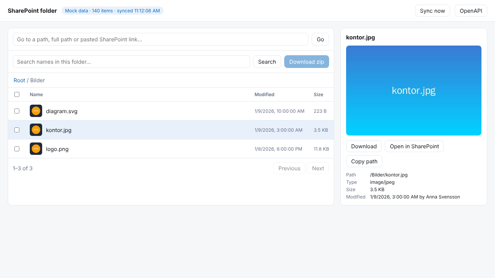
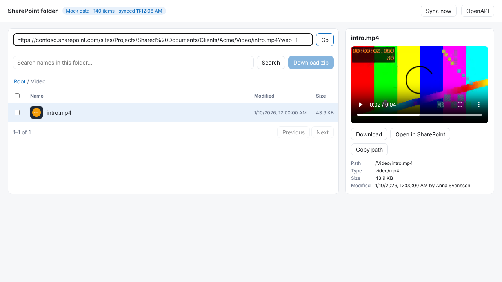
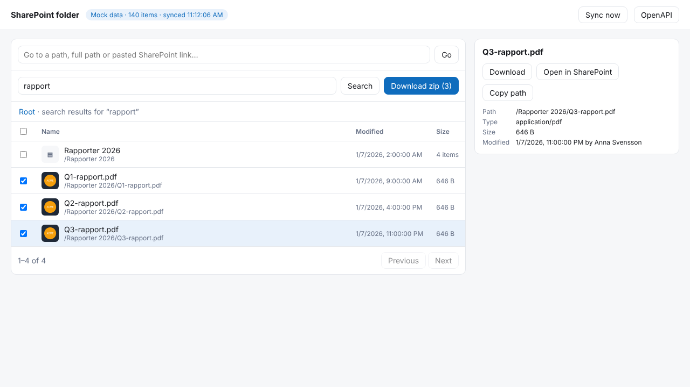

# cf-worker-sharepoint

A read-only Cloudflare Worker API over **one folder in a SharePoint document library**. It lists, searches, serves, downloads and zips files through Microsoft Graph, using its own app identity.

Listing and search never call SharePoint. They are answered from a D1 mirror of the library's metadata, which a cron-triggered **delta sync** keeps up to date. Graph is only called when file content is needed.

A small proof-of-concept browser UI is served at `/`. It's meant to be replaced; the API is the product.

| Browse a folder and preview files | Paste any SharePoint link to jump to it | Search, select and download as zip |
|---|---|---|
|  |  |  |

<sub>Screenshots use the built-in mock library (`npm run dev:mock`).</sub>

```
             ┌──────────────── Cloudflare Worker ────────────────┐
  client ──▶ │  /api/items, /api/search ──▶ D1 (mirror + FTS)    │
             │  /api/content, /download,                         │
             │  /thumbnail, /zip         ──▶ Microsoft Graph ────┼──▶ SharePoint
             │  cron (*/2 min) ── delta sync ──▶ D1              │
             └───────────────────────────────────────────────────┘
```

> **No authentication is built in.** Whoever can reach the Worker can read the whole configured folder. Put it behind your own gate (Cloudflare Access, a calling Worker via a service binding, an API gateway).

## API

The full spec is at `GET /openapi.json` (OpenAPI 3.1).

| Endpoint | What it does |
|---|---|
| `GET /api/items?path=&limit=&offset=&sort=&order=&type=` | List a folder. Folders first, then files. Returns `items`, `total` and `index` (sync state) |
| `GET /api/item?path=` | Metadata for one file or folder |
| `GET /api/resolve?path=` | Normalize any accepted path format (see below) to the canonical path |
| `GET /api/search?q=&path=&type=&ext=&modifiedAfter=&modifiedBefore=&minSize=&maxSize=&sort=&limit=&offset=` | Search names (word-prefix, accent-insensitive) and metadata within the `path` subtree |
| `GET /api/download?path=` | 302 redirect to a short-lived, pre-authenticated SharePoint download URL |
| `GET /api/content?path=&disposition=inline\|attachment` | Stream the file through the Worker, with `Range` support (206) for video seeking |
| `GET /api/thumbnail?path=&size=small\|medium\|large` | Graph-generated thumbnail, cached at the edge per file version |
| `POST /api/zip` `{ "paths": [...], "name"?: "..." }` | Prepare a zip of files and/or folders (recursive). Returns a URL that is valid for 1 hour |
| `GET /api/zip/{id}` | Stream the prepared zip |
| `GET /api/zip?path=&path=&name=` | Stream a zip directly, for plain links |
| `GET /api/status` | Configuration and sync status |
| `POST /api/sync` | Run a sync pass now (the cron does this automatically) |

Pagination is always `limit` (1–1000, default 100) plus `offset`, and every list response includes `total`.

Errors look like `{ "error": { "code": "NOT_FOUND", "message": "..." } }`. The codes are `BAD_REQUEST`, `NOT_FOUND`, `NOT_A_FOLDER`, `NOT_A_FILE`, `LIMIT_EXCEEDED` (413), `INDEX_NOT_READY` (503), `UPSTREAM_ERROR` and `UPSTREAM_AUTH_ERROR` (502).

### Path formats

`path` accepts all of these. Responses always return the canonical form, which is relative to the root folder (`/` is the root itself):

| Format | Example |
|---|---|
| Relative to the root folder | `/Reports/Q3.pdf`, `Reports/Q3.pdf` |
| Full server-relative path | `/sites/Projects/Shared Documents/Clients/Acme/Reports/Q3.pdf` |
| Library-relative path (URL segment or display name) | `Shared Documents/Clients/Acme/Reports/Q3.pdf`, `Dokument/Clients/Acme/...` |
| Browser URL | `https://contoso.sharepoint.com/sites/Projects/Shared%20Documents/Clients/Acme/Reports/Q3.pdf?web=1` |
| Library view URL | `https://.../Shared%20Documents/Forms/AllItems.aspx?id=%2Fsites%2FProjects%2F...` |
| "People with existing access" link | `https://contoso.sharepoint.com/:b:/r/sites/Projects/Shared%20Documents/...` |
| Sharing link | `https://contoso.sharepoint.com/:b:/s/Projects/EfAbC...?e=XyZ`, resolved through Graph `/shares` |

Matching is case-insensitive. Anything that resolves outside the root folder returns 404. `.` and `..` segments are rejected.

### Serving files safely

`/api/content` serves PDF, images, audio, video and plain text inline. Everything else, including HTML, is always sent as an attachment, so uploaded documents can't run scripts on the Worker's origin. SVG is served inline but with a `Content-Security-Policy: sandbox`.

## How the sync works

- SharePoint only supports delta on the **drive root**, so the Worker mirrors metadata for the **whole library** and restricts every query to the root folder. This is also what makes moves into and out of the root folder work.
- Delta responses don't include item paths, so paths are computed from parent ids. When a folder is renamed or moved, SharePoint reports only the folder, and the Worker rewrites the paths of everything below it.
- The sync is **resumable**. Each run works within `SYNC_TIME_BUDGET_MS` and saves Graph's continuation link, so a large initial sync spreads over several cron runs. Reads keep working in the meantime; `index.ready` is `false` until the first full pass completes.
- If Graph answers **410** (the delta token expired), a full resync starts. Old rows keep serving reads until it finishes, and rows that no longer exist are removed at the end.
- A lock in D1 ensures only one sync runs at a time.

Results can lag SharePoint by up to the cron interval. File content is always fetched live, so a file deleted since the last sync returns 404, and zips skip such files (reported in the `x-zip-skipped-files` header).

### Zips

Zips are streamed with no compression (most documents and media are already compressed) and switch to Zip64 automatically when needed.

Before streaming, the Worker refreshes each file's size and download URL from Graph in `$batch` calls, so `Content-Length` is exact and browsers show real progress.

Limits:
- `ZIP_MAX_FILES` (default 500). Each file is one outbound request, and Workers cap subrequests per invocation.
- `ZIP_MAX_BYTES` (default 2 GiB). Zipping computes a CRC32 over every byte, roughly 300–400 MB per second of CPU. The default 30 s CPU limit covers that. For larger zips, raise `limits.cpu_ms` in `wrangler.jsonc` (Workers Paid plan).

## Setup

### 1. In Microsoft Entra ID (the organization's IT)

1. **Register an app** (single tenant). Note its *Application (client) ID* and *Directory (tenant) ID*.
2. **Add the credential.** Either upload a **certificate** (preferred by most IT departments) or create a **client secret**.
3. Under *API permissions*, add **Microsoft Graph → Application permissions → `Sites.Selected`**, then **grant admin consent**.
4. **Grant the app read access to the one site.** `Sites.Selected` alone grants nothing. A SharePoint or Global admin must assign the site explicitly, for example:

   ```http
   POST https://graph.microsoft.com/v1.0/sites/{site-id}/permissions
   Content-Type: application/json

   {
     "roles": ["read"],
     "grantedToIdentities": [{ "application": { "id": "<client-id>", "displayName": "cf-worker-sharepoint" } }]
   }
   ```

   Or with PnP PowerShell:
   `Grant-PnPAzureADAppSitePermission -AppId <client-id> -DisplayName cf-worker-sharepoint -Site https://contoso.sharepoint.com/sites/Projects -Permissions Read`

To create a certificate:

```sh
openssl req -x509 -newkey rsa:2048 -nodes -days 730 -subj "/CN=cf-worker-sharepoint" -keyout key.pem -out cert.pem
openssl pkcs8 -topk8 -nocrypt -in key.pem -out key.pkcs8.pem   # CERT_PRIVATE_KEY
openssl x509 -in cert.pem -noout -fingerprint -sha1             # CERT_THUMBPRINT (colons are fine)
# Upload cert.pem to the app registration.
```

### 2. In Cloudflare

```sh
npm install
npx wrangler d1 create cf-worker-sharepoint       # paste the database_id into wrangler.jsonc
npm run db:migrate                                # apply migrations to the remote database
npx wrangler secret put TENANT_ID
npx wrangler secret put CLIENT_ID
npx wrangler secret put CERT_PRIVATE_KEY          # or CLIENT_SECRET
npx wrangler secret put CERT_THUMBPRINT
```

Set `SITE_URL`, `LIBRARY` and `ROOT_PATH` in `wrangler.jsonc`, then:

```sh
npm run deploy
curl -X POST https://<worker>/api/sync            # or wait for the cron
curl https://<worker>/api/status
```

### Configuration

| Variable | Default | Meaning |
|---|---|---|
| `SITE_URL` | – | Full site URL, e.g. `https://contoso.sharepoint.com/sites/Projects` |
| `LIBRARY` | site default library | Library display name (`Documents`, `Dokument`) or URL segment (`Shared Documents`) |
| `ROOT_PATH` | whole library | Folder inside the library that the API is locked to, e.g. `Clients/Acme` |
| `ZIP_MAX_FILES` | `500` | Maximum number of files per zip |
| `ZIP_MAX_BYTES` | `2147483648` | Maximum total size of a zip |
| `SYNC_TIME_BUDGET_MS` | `60000` | How long one sync run may work before saving its position |
| `CORS_ORIGINS` | off | Comma-separated allowed origins, or `*` |
| `TENANT_ID`, `CLIENT_ID` | – | Secrets |
| `CLIENT_SECRET` or `CERT_PRIVATE_KEY` + `CERT_THUMBPRINT` | – | Secrets. The certificate wins if both are set. The thumbprint may be SHA-1 or SHA-256 (hex) |

Changing `SITE_URL` or `LIBRARY` wipes and rebuilds the mirror automatically. Changing `ROOT_PATH` takes effect immediately, with no resync, because the whole library is mirrored.

## Local development

No tenant needed. `MOCK_GRAPH=true` swaps Graph for a built-in fake library (Swedish names, special characters, 120-file folder, PDF/image/video/SVG/HTML samples, sharing links):

```sh
npm install
npm run db:migrate:local
npm run dev:mock
# open http://localhost:8787, click "Sync now"
# trigger the cron manually: curl "http://localhost:8787/__scheduled?cron=*/2+*+*+*+*"
```

To run against a real tenant locally, copy `.dev.vars.example` to `.dev.vars`, fill it in and run `npm run dev`.

```sh
npm test            # Vitest in the Workers runtime, against the mock
npm run typecheck
```

The tests cover the sync (paging, resuming, out-of-order parents, folder renames, moves in and out of the root, deletes, 410 resync, throttling, locking), every path format, root-boundary enforcement, search, Range requests, inline/attachment rules, thumbnails, zip contents and `Content-Length`, limits, and certificate assertion signing.

`.npmrc` sets `legacy-peer-deps` to work around an npm bug with Vitest's optional peer dependencies.

## To verify against the real tenant

These are built to Microsoft's documented behaviour but could only be tested against the mock:

- **Sharing-link resolution** (`/shares/{id}/driveItem`) with app-only `Sites.Selected` read access. Other path formats don't depend on it.
- **Initial sync duration** for the actual library size (watch `/api/status`).
- That **`$select` on delta** returns everything needed in that tenant (`deleted`, `root` and `parentReference` in particular).

## Project layout

```
src/
  index.ts              fetch + scheduled handlers
  app.ts                routes (Hono + zod-openapi)
  env.ts                configuration
  graph/                token (secret or certificate), Graph client with retries, types
  sync/delta.ts         delta sync into D1
  sharepoint/           drive resolution, path helpers, path/URL resolver
  db/                   item queries and search (FTS5), meta
  api/                  file serving, thumbnails, zip
  mock/                 fake Graph + SharePoint library for dev and tests
  ui.ts                 proof-of-concept browser
migrations/             D1 schema
test/                   Vitest suites
```
